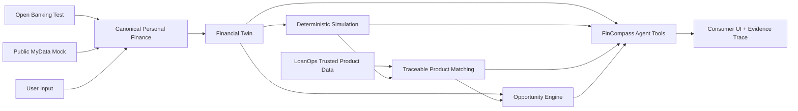

# FinCompass Agent

FinCompass Agent는 MyData 기반 개인 재무 상태를 재현 가능한 계산과 상품 데이터에 연결해, “이 결정을 감당할 수 있는가?”를 근거와 함께 설명하는 금융 의사결정 에이전트다. 대출 비교 화면은 상품 조건만 보여주고, 일반 MyData 대시보드는 과거 상태를 요약하며, 단순 계산기는 개인의 현금흐름·기존 부채·데이터 품질을 함께 추적하지 못한다. 이 프로젝트는 검증된 원천에서 시작해 계산·시뮬레이션·상품 검토·설명까지 하나의 감사 가능한 흐름으로 묶는다.

## 제품 개념과 사용자 흐름

사용자는 Open Banking 테스트 데이터, Public MyData mock 소득 근거, 명시적 사용자 입력으로 Financial Twin을 만든다. “7억 아파트를 사도 될까?”라는 질문에 필요한 현금·대출·금리·기간을 명시하면 backend가 주택구매 전후, 스트레스, 상품 후보, 기회·위험을 계산한다. Agent는 이 도구 결과만 설명하며 숫자를 직접 계산하지 않는다.



## LoanOps에서 FinCompass로

기존 LoanOps의 수집, immutable raw snapshot, source별 정규화, 품질 검증, 격리, publication, serving pointer와 운영 콘솔을 그대로 유지했다. FinCompass의 상품 매칭은 별도 catalog를 만들지 않고 LoanOps serving projection을 읽는다. 후보마다 product/term/raw/source/publication ID와 hash를 동결하므로 이후 serving 값이 바뀌어도 이전 실행이 달라지지 않는다.

## 데이터 연결과 실제성 경계

- **Open Banking:** OAuth/token lifecycle과 production-shaped LIVE_TEST adapter가 있다. 기본 데모는 `DEMO_REPLAY`; 실제 금융결제원 호출은 `LIVE_TEST_NOT_VERIFIED`다.
- **Public MyData:** provider-neutral consent/evidence 계약과 `PUBLIC_MYDATA_MOCK`만 제공한다. 실제 정부 연동은 구현하지 않았다.
- **Canonical Personal Finance:** provider evidence를 계좌·잔액·거래·검증소득·재직 근거로 승격하며 동의, provenance, validation run을 보존한다.
- **AI-Hub:** 사용자 연결 데이터가 아니며 `OFFLINE ONLY` 경계만 표시한다.
- **Golden 상품:** LoanOps의 실제 수집/정규화/품질/publication 코드를 통과하는 합성 fixture다. origin은 항상 `sourceType=DEMO_PRODUCT_FIXTURE`, mode는 `DEMO_REPLAY`다. `REAL_PRODUCT_DATA`는 실제 trusted source로 수집된 상품에만 사용한다.

## Financial Twin

V11의 snapshot은 원천 reference, 사용자 fact, 분류된 거래, 지표와 계산 규칙을 암호화된 append-only 이력으로 저장한다. 14개 지표를 `BigDecimal`로 계산한다. 관측 거래 월유출 340만 원, 별도 모델 고정의무 20만 원, 모델 총 월유출 360만 원을 구분한다. 비상자금은 생활비 280만 원이 아니라 명시적 필수지출 220만 원을 분모로 사용한다. 결측과 0 분모는 0으로 바꾸지 않고 availability와 warning으로 남긴다.

## 재무 시뮬레이션

`FINANCIAL_SIMULATION_V1`은 원리금균등 상환표를 월 단위 `HALF_EVEN`으로 만들고 마지막 회차 잔액을 정확히 0으로 정산한다. 주택구매는 같은 metric schema로 Before/After를 제공한다. 기본 스트레스는 금리 +1/+2/+3%p, 소득 −10/−20/−30%, 지출 +10/+20%, 유동자산 −20/−30%, 복합 충격이다. Monte Carlo, 세금 추정, LLM 계산은 없다.

## 상품 매칭

Hard Filter가 품질, 금액, 기간, 상환방식, 적격성 결측을 먼저 처리한 뒤에만 `PRODUCT_MATCH_SCORE_V1`을 실행한다. 완전한 후보의 점수 가중치는 affordability 35, interest cost 25, stress resilience 20, preference fit 10, data quality 10이다.

두 데모가 같은 trusted pipeline을 지난다. **Demo A — 안전성/정직성**은 원천 필드가 불완전한 4개 term을 `INSUFFICIENT_DATA`, score/rank `null`로 유지한다. **Demo B — 전체 매칭 역량**은 완전히 명시된 합성 상품 4개에 Hard Filter → 후보 시뮬레이션 → +2%p stress → score → Review Candidate rank를 실행한다. 모두 `DEMO_PRODUCT_FIXTURE`이며 실제 상품·승인·적격성을 뜻하지 않는다.

## Target Scenario Search

“7억은 부담이 큰데 월 여유자금 50만 원을 유지하려면?”이라는 질문은 LLM이 계산하지 않는다. `TARGET_HOME_PRICE_SEARCH_V1`이 고정 현금기여·금리·기간·상환방식과 사용자가 명시한 제약에서 10만 원 정밀도의 bounded binary search를 수행한다. Golden 결과는 최대 테스트 가능 집값 **248,100,000원**, 필요 주담대 **138,100,000원**, 월납입 **699,732.41원**, 구매후 월 여유 **500,267.59원**이다. 이는 `Simulation Boundary`이며 공식 감당가능가격이나 추천이 아니다.

## Opportunity Engine

`OPPORTUNITY_V1`은 유동성 위험, 부채부담 경고, 금리 재검토, 대환 검토를 근거·threshold·rule version과 함께 append-only 이벤트로 저장한다. incomplete/stale/partial snapshot에서는 판단을 막고 같은 근거의 이벤트를 중복 생성하지 않는다.

## FinCompass Agent

`AgentModelClient`는 공급자 중립 경계다. 기본 `FINCOMPASS_AGENT_MODE=DEMO`는 외부 LLM 없이 결정론적으로 intent와 tool flow를 선택한다. `LLM` mode는 OpenAI Responses API adapter를 사용한다. LLM은 intent 선택과 설명만 담당하고, 15개 typed tool과 결정론적 backend가 모든 금융 숫자·시뮬레이션·순위를 만든다. 임의 SQL·코드 실행 도구는 없으며 필수 입력이 없으면 값을 만들지 않고 `NEEDS_INPUT`을 반환한다.

최종 설명의 모든 숫자 token은 사용자 입력 또는 tool result 숫자 집합과 대조한다. 근거 없는 숫자가 있으면 모델 초안을 버리고 결정론적 설명으로 대체한다. 실행·도구 call은 params/result hash, snapshot/scenario/match ID, 규칙, 가정, warning, limitation, 최종 설명과 함께 암호화된 append-only trace로 남는다.

## Consumer UI

기본 화면은 `#/fincompass/dashboard`다. Data Connections, Financial Dashboard, Ask Agent, Scenario, Candidates, Stress, Alternatives, Opportunities, Evidence의 9개 route가 있다. DEMO banner, source badge, 결측·stale·partial·error 상태와 warning을 숨기지 않는다. 기존 LoanOps 운영 콘솔은 `#/admin`에서 유지한다. Vitest/React Testing Library가 핵심 소비자 상태 7개를 자동 검증한다.

## 기술 스택

- Java 21, Spring Boot 3.5, Gradle, PostgreSQL 17, JPA, Flyway
- React 19, TypeScript 5, Vite 7
- JUnit 5, Testcontainers, WireMock, AssertJ
- AES-GCM context-bound payload encryption, SHA-256/HMAC identity

## 프로젝트 구조

```text
src/main/java/com/loanops/       LoanOps + FinCompass backend
src/main/resources/db/migration Flyway V1–V15
src/main/resources/fixtures     명시적 DEMO/MOCK fixture
src/test                        unit/integration/Golden E2E
frontend/src/views              기존 LoanOps 운영 화면
frontend/src/consumer           FinCompass 소비자 화면
docs/implementation             설계·검증·Golden 결과
scripts/run-golden-demo.sh      clean demo bootstrap
```

## 로컬 실행

필수 도구는 JDK 21, Node.js 20.19+, Docker Desktop이다. 일반 개발 실행은 `.env.example`을 `.env`로 복사하고 로컬 DB password와 Base64 32-byte encryption key를 넣은 뒤 시작한다.

```bash
docker compose --env-file .env up -d postgres
set -a; source .env; set +a
./gradlew bootRun
```

별도 터미널에서:

```bash
cd frontend
npm ci
npm run dev
```

## 자격증명 없는 Golden Demo

새 PostgreSQL volume이 가능한 clean 환경에서 다음 한 명령이 로컬 DB password와 encryption key를 매번 생성하고, DB·V1→V15 migration·개인 Golden 원천·LoanOps 합성 상품 pipeline을 시작한다. 외부 금융/API/LLM 자격증명은 사용하지 않는다.

```bash
./scripts/run-golden-demo.sh
```

그 다음 `frontend`에서 `npm run dev`를 실행하고 [http://localhost:5173](http://localhost:5173)을 연다. 기본 Golden 질문과 입력은 UI에 명시되어 있다. 스크립트는 production data reset endpoint를 만들지 않는다.

직접 backend를 실행하려면 `SPRING_PROFILES_ACTIVE=fincompass-demo,golden-products`와 DB/encryption 환경변수를 사용한다. demo profile은 `127.0.0.1`에만 bind된다.

## 주요 환경변수

- DB: `DATABASE_URL`, `DATABASE_USERNAME`, `DATABASE_PASSWORD`
- Open Banking: `OPEN_BANKING_MODE`, `OPEN_BANKING_BASE_URL`, `OPEN_BANKING_AUTHORIZATION_URI`, `OPEN_BANKING_TOKEN_URI`, `OPEN_BANKING_CLIENT_ID`, `OPEN_BANKING_CLIENT_SECRET`, `OPEN_BANKING_REDIRECT_URI`, `OPEN_BANKING_ENCRYPTION_KEY`
- 개인 layer: `PERSONAL_FINANCE_ENABLED`, `PERSONAL_FINANCE_ENCRYPTION_KEY`, stale/policy 설정
- CORS: `LOANOPS_API_ALLOWED_ORIGINS`
- Agent: `FINCOMPASS_AGENT_MODE=DEMO|LLM`, `OPENAI_BASE_URL`, `OPENAI_MODEL`, `OPENAI_API_KEY`

실제 secret은 환경변수 또는 git-ignored local profile에만 둔다. `.env.example`은 placeholder만 포함한다.

## API

Financial Snapshot/analytics, Scenario, Product Match, Opportunity, Agent/trace API와 demo 예시는 [API.md](docs/implementation/API.md)에 정리했다. 개발 실행에서는 `/swagger-ui.html`, OpenAPI JSON은 `/v3/api-docs`다.

## 테스트

```bash
JAVA_HOME=/path/to/jdk-21 ./gradlew clean test bootJar --no-daemon
cd frontend && npm test -- --run && npm run typecheck && npm run build
```

모든 금융 계산은 독립 기준값 또는 정확한 expected value로 검증한다. 외부 LLM에 의존하는 테스트는 없다. 최종 실제 실행 수는 [STATUS.md](docs/implementation/STATUS.md)에 기록하며, clean-DB E2E가 생성한 값은 [GOLDEN_RESULTS.md](docs/implementation/GOLDEN_RESULTS.md)에 있다.

포트폴리오 캡처 항목과 실제 앱 탐색 순서는 [SCREENSHOT_GUIDE.md](docs/SCREENSHOT_GUIDE.md)에 있다.

## 알려진 제약과 향후 작업

- 금융결제원 LIVE_TEST 실제 호출, 실제 Public MyData 정부 연동, 실제 OpenAI credential runtime 호출은 검증하지 않았다. OpenAI adapter 자체는 WireMock으로 검증했다(`REAL_LLM_RUNTIME_NOT_VERIFIED`).
- consumer API는 loopback demo owner 전용이며 production 다중 사용자 인증 UI가 아니다.
- Golden 상품은 모두 합성 replay다. 불완전 fixture는 의도적으로 score/rank가 없고, 완전 fixture는 오직 매칭 파이프라인 시연용 Review Candidate를 만든다.
- 세금·취득비용·미래 집값·소득 상승을 추정하지 않는다.
- key rotation, retention/legal deletion, provider correction/versioning 운영 절차가 필요하다.
- 향후 작업은 LIVE sandbox 검증, production 인증/동의 UI, 실제 eligibility field 계약, key rotation/retention이다.

## 면책

FinCompass Agent의 결과는 정보 제공용 시뮬레이션이다. 대출 승인, 보장된 적격성, 상품 추천, 금융 자문이 아니다. 금융 결정을 내리기 전에 실제 금융기관 조건과 전문가 검토가 필요하다.
