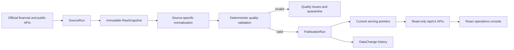

# LoanOps

LoanOps is a financial public-data integration and operations platform focused on correctness, traceability, data integrity, and operational reliability. It includes official-source ingestion, immutable raw preservation, source-specific normalization, quality-controlled publication, read-only operational APIs, and a React operations console.

## Stack

- Java 21
- Spring Boot 3.5.16
- Gradle 8.14.3 Wrapper
- PostgreSQL 17.11
- Spring Data JPA
- Flyway
- Spring Boot Actuator
- springdoc OpenAPI 2.9.1
- JUnit 5, Testcontainers 2.0.5, and WireMock 3.13.2
- Docker Compose
- React 19, TypeScript, and Vite 7

## Architecture



Ingestion, normalization, quality validation, publication, and serving are deliberately separate lifecycle stages. Every current serving record remains traceable through its normalized record and raw snapshot to the exact source execution.

## Prerequisites

- JDK 21
- Node.js 20.19+ and npm
- Docker Desktop or another Docker-compatible runtime with Compose

## Local setup

Create a local environment file and replace both password placeholders with the same private local value:

```bash
cp .env.example .env
```

Start PostgreSQL:

```bash
docker compose --env-file .env up -d postgres
docker compose --env-file .env ps
```

Export the application connection settings and run the backend:

```bash
set -a
source .env
set +a
./gradlew bootRun
```

The application intentionally has no hard-coded database credential fallback. It fails fast when `DATABASE_URL`, `DATABASE_USERNAME`, or `DATABASE_PASSWORD` is missing. Official API credentials and endpoints are also supplied only through environment variables.

## Source ingestion

Each ingestion attempt follows one explicit lifecycle:

1. Persist a `RUNNING` `SourceRun` in its own transaction.
2. Call the configured official API outside that transaction.
3. Preserve every HTTP response body and its SHA-256 hash in a new `RawSnapshot` before interpreting the source result code.
4. Treat only Seoul `INFO-000` and FinLife `result.err_cd=000` as source-level success.
5. Mark the run `SUCCESS`, or persist a sanitized `UPSTREAM_ERROR` and mark it `FAILED`, in an independent transaction before returning or propagating an application exception.

An HTTP 2xx status alone is not sufficient for source execution success. The current adapters are `FSS_FINLIFE` for JSON and `SEOUL_POLICY_LOAN_RATE` for XML. Test fixtures are deterministic test inputs only and are never used as production fallback data.

Seoul ingestion uses a configurable page size of five by default. It reads `list_total_count` from the first valid response and requests only the remaining deterministic ranges. One logical `SourceRun` owns every page as a separate immutable `RawSnapshot`. The run succeeds only after every page succeeds; a failed page and every preceding page remain preserved, later pages are not requested, and no retry occurs.

## Phase 3 normalization

Normalization is explicitly separated from ingestion:

```text
FSS FinLife RawSnapshot -> InstitutionAlias -> FinancialInstitution
                       -> LoanProduct -> ProductTerm

Seoul dreamMoney RawSnapshot -> InstitutionAlias -> FinancialInstitution (nullable)
                            -> LoanRateObservation
```

FSS records are disclosed mortgage-product conditions and option rates. Seoul records are aggregated execution statistics for policy-linked commercial-bank financing. A Seoul `LoanRateObservation` is never linked to an FSS `LoanProduct`; the only shared dimension is an explicitly mapped institution.

FSS institution codes and names create or resolve canonical institutions by exact source identity. Seoul uses only seeded, explicitly confirmed code-and-name mappings. Unknown or uncertain Seoul identities are retained as `UNMAPPED`, their observations remain queryable, and their canonical institution is null. No fuzzy or approximate matching is performed.

Every `LoanProduct`, `ProductTerm`, and `LoanRateObservation` has a direct foreign key to the exact `RawSnapshot` that produced it. Snapshot-scoped source identities are protected by database unique constraints, and normalization uses deterministic lookup-before-insert behavior. Repeating normalization for the same successful run therefore creates no duplicates. One normalization invocation is transactional: malformed source data causes the entire invocation to roll back rather than partially commit.

## Manual official-API ingestion

Manual ingestion is disabled during normal startup and runs only with the `manual-ingestion` profile. Set the relevant variables in your uncommitted `.env` file, including the API key, base URL, and source-specific path or service name. Then run one source:

```bash
set -a
source .env
set +a
./gradlew bootRun --args='--spring.profiles.active=manual-ingestion --loanops.manual.source=FSS_FINLIFE'
```

For the Seoul source:

```bash
./gradlew bootRun --args='--spring.profiles.active=manual-ingestion --loanops.manual.source=SEOUL_POLICY_LOAN_RATE'
```

The profile uses a non-web application context, performs exactly one attempt, prints only the source code, run ID, status metadata, and payload hash, and then exits. It never prints API keys or authenticated request URLs. A failed attempt remains stored as `FAILED` and causes the command to fail. There is no automatic retry or scheduler.

## Manual normalization

Normalization is disabled during normal startup. After a successful ingestion, normalize that specific run:

```bash
set -a
source .env
set +a
./gradlew bootRun --args='--spring.profiles.active=manual-normalization --loanops.manual.run-id=<SOURCE_RUN_ID>'
```

The selected run must be `SUCCESS`. For Seoul, every snapshot in the paginated run is parsed and validated together. Failed runs, incomplete page sets, malformed records, and inconsistent totals are rejected without a partial normalized commit.

## Phase 4 quality and publication

Source ingestion success, normalization, quality validation, and serving publication are separate lifecycle stages. A `SUCCESS` `SourceRun` remains successful even when its normalized records later fail quality validation.

The deterministic quality rules check required source identities, valid date order, and non-negative rates and counts. For FSS terms, minimum, maximum, and optional average rates must each be non-negative, while ordering requires only `minimum_rate <= maximum_rate`; the official response contract does not establish that the reported average uses the same basis as those bounds. Seoul observations retain `minimum <= average <= maximum` validation. No arbitrary maximum-rate threshold, scoring, or heuristic rule is used. Publication decisions record quality policy version `2026-09-v2`; pre-existing Phase 4 decisions are retained as `2026-09-v1` history.

Each violation is stored as a `DataQualityIssue`. An invalid normalized record also receives one `QuarantineRecord`, regardless of how many issues it has. Quarantine means that the immutable normalized record was rejected from serving; it does not delete or duplicate the normalized data.

The serving layer contains only stable identities and pointers to current normalized records:

```text
serving_loan_products -> loan_products -> raw_snapshots -> source_runs
serving_product_terms -> product_terms -> raw_snapshots -> source_runs
serving_loan_rate_observations -> loan_rate_observations -> raw_snapshots -> source_runs
```

Validation evidence is committed before publication. If any record in the selected source run is invalid, the publication result is `REJECTED_QUALITY` and no pointer from that run is promoted. Existing serving pointers remain unchanged. For valid runs, pointer changes and deterministic `DataChange` rows commit atomically.

Business-identical normalized snapshots produce `NO_CHANGE`, create no `DataChange`, and do not rewrite serving pointers. `NO_CHANGE` belongs to `PublicationRun`; it does not alter `SourceRun.SUCCESS`. Change detection compares explicit normalized business fields and ignores provenance-only differences. `REMOVED` is not inferred because the current source completeness semantics are not sufficient for safe deletion from serving.

Publication is disabled during normal startup. Process one normalized source run explicitly:

```bash
set -a
source .env
set +a
./gradlew bootRun --args='--spring.profiles.active=manual-publication --loanops.manual.run-id=<SOURCE_RUN_ID>'
```

The command returns `PROMOTED`, `REJECTED_QUALITY`, or `NO_CHANGE` with sanitized issue, quarantine, and change counts. Re-running a finalized source run safely returns the existing publication result.

## Phase 5 read-only interface

All portfolio and dashboard APIs are read-only and use dedicated response DTOs. JPA entities, authenticated source URLs, API keys, and complete raw payloads are never serialized. Operational lists use deterministic database ordering and zero-based pagination with a maximum page size of 100.

| Endpoint | Purpose |
| --- | --- |
| `GET /api/v1/overview` | Source lifecycle, serving, quality, quarantine, and recent seven-day change counts |
| `GET /api/v1/source-runs` | Filtered and paginated source execution history |
| `GET /api/v1/source-runs/{id}` | Source, snapshot metadata, publication, and normalized-count detail |
| `GET /api/v1/publications` | Paginated final publication decisions |
| `GET /api/v1/publications/{id}` | Publication with quality, quarantine, and change evidence |
| `GET /api/v1/quality-issues` | Filtered and paginated quality evidence |
| `GET /api/v1/data-changes` | Filtered and paginated serving change history |
| `GET /api/v1/serving/loan-products` | Current FSS products reached through serving pointers |
| `GET /api/v1/serving/loan-products/{id}` | Current FSS product and current product terms |
| `GET /api/v1/serving/loan-rate-observations` | Current Seoul policy-linked commercial-bank loan execution statistics |

Raw snapshot information is metadata-only: content type, SHA-256 hash, payload byte size, and fetch timestamp. No raw-preview endpoint is included.

For local frontend development, the backend allows `http://localhost:5173` only. Override the comma-separated allowlist with `LOANOPS_API_ALLOWED_ORIGINS`; wildcard CORS is not used.

Start the frontend in a second terminal:

```bash
cd frontend
npm install
npm run dev
```

Vite proxies `/api` requests to `http://localhost:8080`. The console provides Dashboard, Source Runs, Data Quality, and Serving Data views. It reads historical behavior directly from the database and never hard-codes demonstration run IDs.

## Real-data demo flow

1. Start PostgreSQL and the backend using the local setup commands.
2. Start the frontend and open <http://localhost:5173>.
3. Use Dashboard to compare the latest ingestion and publication state for both sources.
4. Open Source Runs to inspect HTTP-200 upstream failures and their preserved snapshot metadata.
5. Open Data Quality to compare historical policy decisions and their immutable issue evidence.
6. Open Serving Data to view the current FSS products and Seoul policy-linked execution statistics.

## Dashboard screenshots

Add final portfolio screenshots here after running the console with the verified local real-data database.

## Verification

Run the complete test suite. The integration tests start real PostgreSQL 17.11 containers, use WireMock for deterministic HTTP behavior, and do not use H2 or real API credentials:

```bash
./gradlew test --rerun-tasks --no-daemon
cd frontend
npm install
npm run typecheck
npm run build
```

With the application running, verify Actuator health and OpenAPI:

```bash
curl --fail http://localhost:8080/actuator/health
curl --fail http://localhost:8080/v3/api-docs
```

Open Swagger UI at <http://localhost:8080/swagger-ui.html>.

Stop the local database without deleting its data:

```bash
docker compose --env-file .env down
```

Delete the local database volume only when intentionally resetting local data:

```bash
docker compose --env-file .env down --volumes
```

## Current phase boundary

Phase 5 adds only read-only operational APIs and the React console over the verified Phase 1–4.1 lifecycle. It does not add ingestion, normalization, quality, or publication writes; retry, scheduling, authentication, authorization, operator mutation workflows, overrides, notifications, distributed infrastructure, or AI features.
