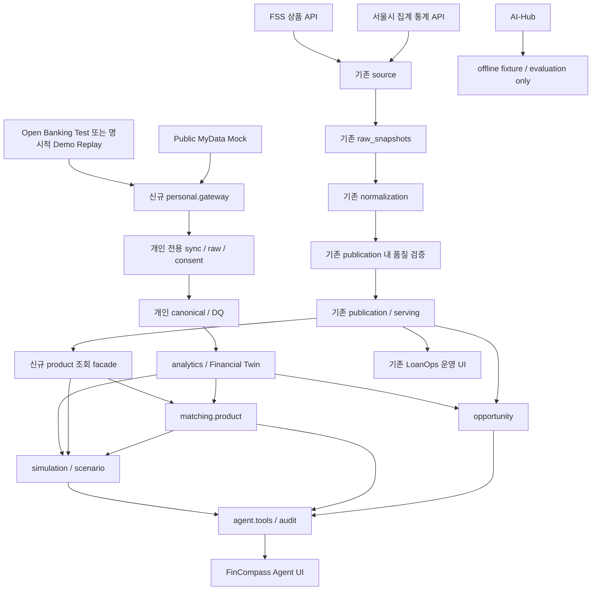

# FinCompass Agent - PDF 요구사항 및 아키텍처 매핑

작성일: 2026-09-21 (Asia/Seoul). 이 문서는 Phase 0 요구 추출과 당시 구현 전 mapping을 보존한다. “미구현/신규 필요” 표기는 그 시점의 gap이며 최종 상태는 `STATUS.md`, 실제 값은 `GOLDEN_RESULTS.md`가 우선한다.

## 기준 문서와 해석 원칙

- Source of truth: `docs/FinCompass_Agent_Project_Plan.pdf`, 28쪽 전체.
- PDF SHA-256: `90733790831ed8deaa5607d3b45653f12404aa9e93056153a30d19aeee9bbf2b`.
- 코드 기준: Loanops `e9227c3491804b5892bc71e151608a044a26263c`.
- PDF 본문 전체를 페이지별 추출해 읽고, 28쪽 전체 렌더링을 확인했다. p.6 시스템 아키텍처와 p.17 Agent 흐름은 개별 확대 확인했다. p.27은 본문 없이 페이지 번호만 있다.
- PDF는 제품/아키텍처 기준이다. 사용자가 채택한 Master Prompt는 제품명 `FinCompass Agent`, 모드 이름, 작업 절차 등의 추가 제약이다. 아래의 새 클래스명·물리 테이블명·세부 구현 선택은 **설계 제안**이며 이미 구현되었거나 PDF에 확정된 것으로 취급하지 않는다.
- PDF의 `LoanOps AI`는 향후 사용자 노출 영역에서 `FinCompass Agent`로 적용한다. `LoanOps`는 내부 상품 데이터 하위 시스템의 이름으로 유지한다. 이번에는 README/UI/패키지를 변경하지 않는다.
- 코드 경로는 저장소 루트 기준이다. Java 경로의 기본 접두사는 `src/main/java/com/loanops/`, migration은 `src/main/resources/db/migration/`이다.

## 전체 페이지 검토 기록

- p.1: 표지, 프로젝트 정의와 금융상담/승인 대체 금지.
- p.2: Executive Summary와 Twin/Simulation/Stress/Matching/Agent 구성표. 제목은 '4 요소'지만 행은 5개이며 다섯 기능을 모두 범위에 포함한다.
- p.3: 기존 파이프라인 책임표, 제품조회와 개인 의사결정 사이의 공백.
- p.4: 사용자 유형, 주택/대출/대환/유동성/대안 사용례와 승인 보장 금지.
- p.5: Connect → Sync → Validate → Twin → Simulate → Explain 도식, 최초 사용, 선제 이벤트 표.
- p.6: 개인 데이터 Gateway와 LoanOps Serving의 별도 경로가 결정론적 분석/시뮬레이션에서 합류하는 아키텍처.
- p.7: 패키지 예시, 버전 관리 정책, Modular Monolith.
- p.8: Provider 계약/구현체와 개인 금융 엔티티 표.
- p.9: 6개 Twin 지표, 소스별 실제성/런타임 구분, Open Banking 구현 순서.
- p.10: OAuth/잔액/거래/카드/대출 API 표, Public MyData, AI-Hub, canonical 필드표 시작.
- p.11: canonical 표 계속, 검증 소득과 관측 현금흐름 분리, 동기화/DQ/배지.
- p.12: 대출/주택 시뮬레이션, shock grid, 대안 A/B.
- p.13: 대안 C/D, LoanOps 코드 책임 매핑, Opportunity와 traceability.
- p.14: Matching 8단계, 상품 필드/결측 처리 표, 후보 상태.
- p.15: 35/25/20/10/10 점수, synthetic 후보 예제, 매칭 엔티티와 API.
- p.16: 매칭 metadata와 guardrail, Agent 설계 소개.
- p.17: 자연어 → Tool 호출 → Audit Trail → 사용자 설명 그림. 각 Tool에서 audit로 이어지는 점선도 요구사항으로 반영.
- p.18: 14개 Tool, Agent guardrail, audit 기록표.
- p.19: 연결 상태, Dashboard, Chat, Scenario, 후보 비교 UI.
- p.20: 후보 카드 및 Before/After 예시, API 목록, 주택구매 요청 예시.
- p.21: 응답 metadata, 매칭 요청/응답 계약.
- p.22: Phase 0~9와 8주 일정표. 주차표에서 덜 드러나는 Product Matching도 Phase 6의 독립 완료 조건으로 유지.
- p.23: DoD, offline demo replay, 엔진/Agent 평가.
- p.24: DQ/매칭 테스트, 통합 persona 6개 값/출처, 데모 순서. 가로폭이 큰 표는 추출 텍스트와 시각 확인을 함께 사용.
- p.25: 결과 메시지, 운영 제약/보안, MVP 제외.
- p.26: 이후 확장, 포트폴리오 스토리.
- p.27: 본문 없음.
- p.28: 공식 참고자료, synthetic 예시 경고, 최종 MVP 범위.

## 현재 구조를 보존하는 목표 경계

`source`를 `ingestion`으로, `normalization.domain`을 `product`로 이동시키는 일괄 리팩터링은 하지 않는다. 현재 품질 코드는 `publication` 안에 있으므로 독립 `quality` 모듈을 중복 생성하지 않는다. 새 개인 Provider는 기존 `DataSourceCode`와 상품용 lifecycle에 끼워 넣지 않는다. 기존 JPA/Flyway/PostgreSQL과 Spring DI를 유지하며, 상품과 개인의 테이블·접근 서비스·권한 경계를 분리한다. 새 물리 schema 분리 여부는 Phase 1 설계에서 정하되 제2 DB나 제2 migration 프레임워크를 도입하지 않는다.

## 1. 기존 LoanOps 책임

- **PDF**: §2.1 p.3, §5 pp.6~7, §8.1~8.3 p.13.
- **요구사항**: ingestion → raw → normalization → quality/quarantine → publication/serving → change detection 보존. 실패 입력이 마지막 정상 serving을 대체하지 않아야 한다.
- **재사용**: `source/service/SourceIngestionService.java`, `SourceRunLifecycleService.java`, `normalization/SourceNormalizationService.java`, `InstitutionResolver.java`, `publication/QualityValidationService.java`, `PublicationTransactionService.java`; 관련 repository 및 domain.
- **신규**: analytics/matching이 사용하는 읽기 전용 `product` facade. 운영용 거대 DTO나 controller에 금융 계산을 넣지 않는다.
- **DB/API**: 기존 V1~V7, 기존 GET API 유지. 매칭용 canonical product projection은 후속 단계에서 추가.
- **위험/검증**: 현재 FSS는 설정된 한 페이지만 수집하며 normalization은 raw 1개를 요구한다. 서울시 통계는 개별 상품 조건이 아니다. 47개 기존 테스트를 매 단계 회귀 기준으로 유지.

## 2. 개인 금융 데이터 소스

- **PDF**: §6.1~6.5 pp.8~9, §6.7 p.10, §6.10 p.11, §15 p.25.
- **요구사항**: `PersonalFinanceProvider.capabilities/getAccounts/getBalances/getTransactions/getLoans/getCards/getIncomeEvidence`; Open Banking Test, Public MyData Mock, 명시적 local replay, AI-Hub offline 분리.
- **재사용**: Spring 설정/DI, `source/config/SourceRestClientFactory.java`의 HTTP timeout 구성 방식, `PayloadHasher.java`의 SHA-256 계산.
- **신규**: `personal/gateway` 계약, `personal/provider/openbanking`, `personal/provider/publicmydata`, replay adapter. AI-Hub loader는 테스트/오프라인 경로만.
- **DB/API**: 사용자·동의·provider 연결·sync 상태·출처 메타데이터 신규. 소비자 연결상태 DTO/API 필요; PDF는 정확한 연결 API URL을 고정하지 않는다.
- **위험/검증**: p.6 그림의 AI-Hub 공통 상자/화살표를 런타임 통합 허가로 해석하지 않는다. §6.7의 offline 제한이 명시적이다. 서로 다른 데이터셋 개인을 임의 join하지 않는다. sourceType과 ingestionMode를 별개로 저장해야 replay를 live처럼 오인하지 않는다.

## 3. Open Banking 연동

- **PDF**: §6.5 pp.9~10, §6.9 p.11, §12~12.2 pp.22~23.
- **요구사항**: OAuth 2.0, 발급/갱신/만료, scope, 암호화된 token 보관, 잔액/거래 필수, 페이지 완료, overlap incremental sync, dedupe, raw/provenance, 기관/endpoint별 실패 격리. 카드·대출·리스는 capability에 따라 활성화.
- **재사용**: `SourceRunLifecycleService`의 별도 트랜잭션으로 시작/실패 보존하는 패턴, `SeoulLoanRateAdapter.java`와 normalization의 완전성 검증 패턴, WireMock 테스트 방식. 서울식 range pagination 코드를 그대로 복제하지 않는다.
- **신규**: `OpenBankingProvider`, `OpenBankingClient`, `TokenService`, `TokenStore`, cursor 수집기, `PersonalSyncService`, capability DTO; `LIVE_TEST`/`DEMO_REPLAY` 명시적 선택.
- **DB/API**: 개인 연결/token 저장소, `source_sync_run`, `raw_openbanking_snapshot` 신규 필요. OAuth 시작/callback, sync 실행/조회 API는 Phase 1에서 계약을 확정한다. 보안 토큰은 응답 DTO에 포함하지 않는다.
- **위험/검증**: 개발자 계정·client·redirect URI·scope와 카드/대출 사용 가능 여부 미확인. 실제 개발 endpoint E2E는 수행하지 않았다. 반복 cursor, 25/26건 경계, 0건 마지막 페이지, 중간 실패, 토큰 만료/갱신 실패, 재시도 중복을 검증해야 한다. 거래별 안정적인 ID가 없는 경우 중복키 충돌을 별도 설계한다.

## 4. Public MyData 경계

- **PDF**: §6.6 p.10, §6.8 p.11, §15 p.25.
- **요구사항**: 공식 계약에 대응하는 `MockPublicMyDataProvider`; `verifiedAnnualIncome`, `incomeYear`, `employmentStatus`, `evidenceType`, `asOf`, `sourceType=PUBLIC_MYDATA_MOCK`. 실기관 조회로 표현하지 않는다.
- **재사용**: DTO, JPA, raw/evidence 해시와 추적 패턴. 상품 raw 테이블에 민감 evidence를 넣지 않는다.
- **신규**: 소득 evidence 계약, 동의 범위, Mock mapping, 향후 `RealPublicMyDataProvider` 교체 지점. 실제 production provider는 구현하지 않는다.
- **DB/API**: `income_evidence`, consent 연결 신규; Twin/연결 DTO에 기준연도·출처·모의 여부 노출.
- **위험/검증**: 어떤 공식 묶음정보의 어느 버전을 사용할지 미확정. field mapping이 없으면 '공식 계약 호환 완료'라고 부를 수 없다. verified라는 필드명과 실제 검증 여부를 구분하고 mock 출처를 함께 표시. 주민번호/행정문서 이미지 수집 금지.

## 5. Canonical Personal Finance Schema

- **PDF**: §6.2 p.8, §6.8 pp.10~11; 추가 sync/card/income 개념은 §6.5~6.9.
- **요구사항**: financial_user, consent_grant, source_sync_run, raw_openbanking_snapshot, financial_account, balance_snapshot, transaction, card_account, card_bill, loan_account, loan_payment, investment_position, income_evidence, financial_snapshot, financial_metric. 이후 scenario/result, opportunity_event, agent_run/tool_call, matching 기록 추가.
- **재사용**: `normalization/domain/*.java`의 명시적 entity/value, repository 및 SQL FK/unique 제약, Flyway SQL 관례. `LoanProduct`는 보유 대출 `loan_account`와 다른 개념이다.
- **신규**: `personal/{account,transaction,card,loan,income,asset}` 및 snapshot 도메인. 모든 행에 사용자 소유권, source/asOf, 원본 추적, 통화·단위·품질 상태.
- **DB/API**: 모두 신규 개인 모델. 물리 테이블명은 기존 snake_case 복수형 관례를 따르고 `transaction` 예약어 충돌을 피하도록 `financial_transactions` 등 사용 제안. 실제 migration 파일은 아직 없음.
- **위험/검증**: 통화 범위, 계좌 간 이체/카드 정산 중복, 음수 잔액 의미, 취소/정정 거래, 기간/시간대, 자산/부채 분류 미확정. 원천 mapping과 idempotency 테스트 필요.

## 6. Data Quality / Provenance

- **PDF**: §6.9~6.10 p.11, §8.3 p.13, §13.3 p.24.
- **요구사항**: `DUPLICATE_TRANSACTION`, `PAGINATION_INCOMPLETE`, `STALE_BALANCE`, `MISSING_INCOME_EVIDENCE`, `LOAN_PAYMENT_MISMATCH`, `SOURCE_CAPABILITY_MISSING`. 불완전 pagination은 complete Twin 승격 차단. 마지막 정상 snapshot 유지 및 중요한 metric의 source record/evidence 추적.
- **재사용**: `QualityValidationService`, `DataQualityIssue`, `QuarantineRecord`, publication의 검증기록 선저장/원자적 승격/정상 serving 보호 방식.
- **신규**: 개인 전용 rule set, 품질 evidence, freshness policy, snapshot promotion gate, metric lineage.
- **DB/API**: 기존 quality 테이블의 record/rule CHECK는 상품 전용이므로 그대로 재사용 불가. 개인 전용 quality/lineage 저장소 제안. Twin/trace DTO에 completeness·warnings·source timestamps 추가.
- **위험/검증**: freshness SLA와 warning/block 경계 미정. 음수 잔액을 전부 오류로 처리하면 정상 한도대출을 잘못 격리할 수 있다. 일부 기관 실패 시 partial과 complete를 구분. incomplete 승격 차단/정상 snapshot 보존 테스트 필수.

## 7. Financial Twin

- **PDF**: §6.3 p.9, §6.8~6.9 p.11, §12.2 p.23.
- **요구사항**: Net Worth = assets - liabilities; Monthly Free Cashflow = income - living/essential expense - debt service - fixed obligations; Emergency Fund Months = liquid assets / essential expense; Debt Service Burden = annual debt service / annual income; Debt-to-Asset = liabilities / assets; Liquid Asset Ratio = liquid assets / assets.
- **재사용**: BigDecimal, JPA/Flyway, provenance/상태 전이 관례. 기존 재무 계산 엔진은 없다.
- **신규**: `analytics/{cashflow,debt,liquidity,wealth}`, `FinancialSnapshotService`, 순수 계산 함수, versioned calculation policy 및 Clock 주입.
- **DB/API**: financial_snapshot/metric/lineage 신규; `GET /api/v1/financial-snapshots/latest`, `/analytics/cashflow`, `/analytics/debt`.
- **위험/검증**: verified annual income과 observed salary cashflow 별도 저장; 실제 월 현금흐름에 세전 연소득/12를 자동 사용하지 않는다. 0/결측 분모는 0이나 무한대가 아닌 정의된 불가 상태. 생활비에 카드청구·대출상환을 다시 빼지 않도록 정의. 3개 persona의 golden metric 필요.

## 8. Loan Simulator

- **PDF**: §7.1 p.12, §13.1 p.23.
- **요구사항**: 원금·연이율·기간·상환방식 → 스케줄/월 상환액/총이자/잔액/기존 부채 합산 부담. 실제 승인한도가 아님.
- **재사용**: `ProductTerm`의 금리/상환방식 관측값, BigDecimal과 DTO 관례.
- **신규**: `simulation/loan`, Money/Rate 단위, 원리금균등·원금균등·만기일시 지원 정책, 반올림 및 마지막 잔액 정산 규칙.
- **DB/API**: scenario, scenario_assumption, scenario_result 신규; `POST /api/v1/scenarios/loan`.
- **위험/검증**: FSS `분할상환방식`만으로 원금균등/원리금균등을 단정할 수 없음. 실제 source rate는 `3.96` 같은 % 단위, PDF 요청은 `0.04` 소수율이다. 단위 변환 경계를 명시. 0%/1개월/최종회차/만기 balloon golden test를 독립 계산과 비교.

## 9. Home Purchase Simulator

- **PDF**: §7.2 p.12, §11.1~11.2 pp.20~21, §14 pp.24~25.
- **요구사항**: 현재 Twin + 가격/자기자본/대출/금리/기간/부대비용으로 구매 전후 자산·부채·현금흐름·유동성·비상자금 계산.
- **재사용**: 현존 상품 serving과 provenance; Loan Simulator는 신규 선행 의존성.
- **신규**: `simulation/home`, 자금조달 일치 검증, 전후 balance sheet, 비용/예비자금 가정.
- **DB/API**: 공통 scenario 저장 모델; `POST /api/v1/scenarios/home-purchase`; snapshotId, publication/source, assumptions, calculatedAt, ruleVersion, warnings, limitations 필수.
- **위험/검증**: 자기자본이 가용 유동자산을 초과하는 요청, 주택가격+비용과 자금 합계 불일치 거절. 세금·수수료·기존 주거비 대체·자기자본 중 비상금 유지액 미정. PDF의 서로 다른 예시 값을 통합 persona의 정답으로 사용하지 않는다.

## 10. Stress Test

- **PDF**: §7.3 p.12, §13.1 p.23, §14.2 p.24.
- **요구사항**: 금리 +1/+2/+3%p, 소득 -10/-20/-30%, 필수지출 +10/+20%, 투자자산 -20/-30%, 복합 충격. deterministic grid.
- **재사용**: 기존 versioned quality policy의 버전 기록 방식; 실제 shock 엔진은 없음.
- **신규**: `simulation/stress`, immutable base scenario, shock 조합/적용 대상/순서 정책, 동일 metric 비교.
- **DB/API**: scenario에 연결된 shock/결과 저장; `POST /api/v1/scenarios/{id}/stress-test`.
- **위험/검증**: 금리 +2%p는 0.02 가산이며 2% 곱셈 아님. 고정금리에 즉시 재가격을 적용할지 정책 필요. asset drawdown 대상은 PDF의 투자자산이지 모든 현금/주택이 아님. base 비변경·복합 shock·income zero 검증.

## 11. Alternative Scenario Comparison

- **PDF**: §7.4 pp.12~13, §11 p.20.
- **요구사항**: A 지금 구매, B 주택가격 5천만원 하향, C 기존 신용대출 선상환, D 12개월 연기/저축을 동일 metric으로 계산·비교.
- **재사용**: 새 Loan/Home/Twin 엔진을 단일 계산 소스로 공유한다. 기존에는 해당 코드 없음.
- **신규**: `simulation/scenario`, template·비교 service; 사용자 변경 가정과 공통 기준 고정.
- **DB/API**: scenario_assumption/result와 comparison 참조; `POST /api/v1/scenario-comparisons`.
- **위험/검증**: 선상환 수수료, 가용현금 감소와 주담대 증가를 함께 반영. 연기 시 저축액/기존 부채 감소/가격·금리 가정을 숨기지 않는다. 동일 snapshot 또는 차이 명시, 템플릿 간 산식 일관성 테스트.

## 12. Product Matching Engine

- **PDF**: §8.4~8.9 pp.14~16, §11.3 p.21, §13.4 p.24.
- **요구사항**: Goal → Capacity → Serving Candidate → Hard Filter → Candidate Simulation → 동일 Stress → deterministic Ranking → 설명. 대출만. `MATCHED_FOR_REVIEW`, `FILTERED_OUT`, `INSUFFICIENT_DATA`; LLM의 순위/가입조건 창작 금지.
- **재사용**: `publication/repository/ServingLoanProductRepository.java`, `ServingProductTermRepository.java`, `normalization/domain/LoanProduct.java`, `ProductTerm.java`, `PublicationRun`, 운영 read SQL의 pointer join 패턴.
- **신규**: `product/CanonicalLoanProductView`, `matching/product`의 retrieval/filter/candidate simulation/ranking/trace. 가중치 35/25/20/10/10은 설정과 `scoreRuleVersion`으로 관리; component raw/weight/weighted/total/rank 영속화.
- **DB/API**: canonical 상품 필드 확장 필요; product_match_run/candidate, candidate_score_component/scenario_result 신규. `POST /api/v1/loan-product-matches`, `GET /api/v1/loan-product-matches/{id}`. scenarioId 또는 explicit goal + requiredLoanAmount/maxMonthlyPayment/preferredTermYears/repaymentPreferences/topK.
- **위험/검증**: 현재 금액/기간/자격 구조 필드 부족. hard filter 이전 점수 금지. 점수 정규화식·동점 정렬키·누락 component 처리·freshness cutoff 미확정. 보수적 기본 제안: 핵심 조건 불명 후보는 INSUFFICIENT_DATA, rank 제외; 경고만으로 허용 가능한 결측 목록은 별도 정책 승인. 실제 Top-K가 0일 수 있어야 한다.

## 13. Opportunity Engine

- **PDF**: §4.3 p.5, §8.2 p.13, §12 p.22.
- **요구사항**: RATE_REVIEW, REFINANCING_REVIEW, LIQUIDITY_RISK 등 변화 감지. '재검토 신호'로 제시하며 신청/승인 자동화 제외.
- **재사용**: `publication/domain/DataChange.java`, `DataChangeRepository.java`, publication 이력. 지금은 변화가 저장될 뿐 개인 이벤트 consumer는 없다.
- **신규**: `opportunity` 규칙 service, snapshot/product 변경 이후 평가, 중복 이벤트 방지, 근거/규칙 버전.
- **DB/API**: opportunity_event 신규; `GET /api/v1/opportunities`.
- **위험/검증**: threshold/재알림/해제 정책 미정. 신용대출과 주담대·서울 통계 금리를 무조건 비교하지 않는다. 명시적인 재평가 호출 또는 같은 monolith 내 commit 이후 처리부터 시작; Kafka/분산 event infra 불필요.

## 14. AI Agent Tools

- **PDF**: §9 pp.16~18, 특히 §9.1 p.18.
- **요구사항**: get_financial_snapshot, get_cashflow_analysis, get_debt_analysis, search_loan_products, estimate_loan_capacity, simulate_home_purchase, run_stress_test, compare_scenarios, get_opportunity_events, get_calculation_trace, match_loan_products, simulate_product_candidate, compare_product_candidates, get_product_match_trace.
- **재사용**: Spring 서비스/DI와 DTO. 기존 `OperationalReadService`는 내부 고정 SQL의 읽기 서비스이며 Agent가 arbitrary SQL을 받게 하지 않는다.
- **신규**: `agent/tools`, typed input/output schema, provider-neutral orchestration, missing input flow, unsupported number 검증.
- **DB/API**: `POST /api/v1/agent/chat`; tools는 동일 결정론적 service를 호출한다. 별도 tool별 HTTP endpoint 생성은 필수 아님.
- **위험/검증**: 모델/SDK/비용 정책 미정. 현재 LLM 의존성 없음; Phase 8 이전 도입 불필요. 숫자/순위 설명은 tool output/사용자 입력에 한정; prompt만으로 보장하지 말고 typed result/evidence 기반 렌더링과 mock model 평가 필요.

## 15. Agent Audit / Traceability

- **PDF**: §8.3 p.13, §8.8 pp.15~16, §9.3 p.18, §11.2 p.21, §13.2 p.23.
- **요구사항**: agent_run 질문/model/provider/version/start/end/status, tool_call 이름/params/result hash/status, snapshots, assumptions, rule versions, final explanation. 중요 숫자별 계산 근거.
- **재사용**: `PayloadHasher`, raw→normalized→publication trace와 metadata-only 응답 패턴.
- **신규**: `agent/audit`, 계산 trace builder, 결과 content hash/저장 참조, 버전된 replay, 숫자-evidence 연결.
- **DB/API**: agent_run/tool_call 및 결과·snapshot 참조 신규; `GET /api/v1/agent/runs/{id}/trace`; matching trace는 match DTO에 포함 또는 내부 service 제공.
- **위험/검증**: hash만으로 과거 결과를 재생할 수 없음. 재생 가능한 입력/결과와 immutable normalized IDs 보존 필요. LLM 문장을 byte 단위로 재생성하는 것과 결정론적 계산 재현은 구분. audit에도 token/계좌 원문 금지.

## 16. Consumer UI

- **PDF**: §10 pp.19~20, §14.3 p.25.
- **요구사항**: Data Connections, Twin Dashboard, Ask FinCompass Agent, Scenario, Matched Candidates, Stress, Alternatives, Opportunity, Evidence drawer. 기존 LoanOps 운영 화면 보존.
- **재사용**: `frontend/src/components/{MetricCard,StatusBadge,UiState,Pagination}.tsx`, `api.ts`, `types.ts`, `displayText.ts`, CSS의 운영 UI 관례. App은 현재 useState 기반 4개 view, router 없음.
- **신규**: consumer view/DTO, mode/source badges, 경고/가정/한계, before/after, 후보 점수 breakdown과 +2%p 결과/불확실 자격 표시.
- **DB/API**: 별도 UI DB 불필요; 새 API DTO와 연결 API 필요. `fetchJson`은 현재 GET 전용이므로 이후 쓰기 요청 helper 확장. 금융 계산은 frontend에 추가하지 않는다.
- **위험/검증**: AI-Hub는 사용자 연결로 노출 금지. presentation sorting과 persisted rank를 구분. 현재 frontend 자동 테스트/린트 runner 없음; 테스트 도구 추가는 승인 단계에서 별도 판단.

## 17. Demo Mode

- **PDF**: §6.1 p.8, §12.2 p.23, §14 pp.24~25; 명시적 enum 명칭은 Master Prompt 보완.
- **요구사항**: LIVE_TEST와 DEMO_REPLAY를 명확하게 구분, 외부 API 장애에도 deterministic demo 재현. 통합 persona는 연소득 66,000,000 / 현금성 자산 120,000,000 / 기존 신용대출 30,000,000 / 생활비 2,800,000 / 카드청구 1,470,000 / 목표 주택가격 700,000,000 KRW.
- **재사용**: `src/test/resources/fixtures/fss`, `fixtures/seoul`의 fixture 관리 방식. 기존 fixture 자체를 실제 상품 데이터로 표기하거나 runtime 사용자 데이터로 합성하지 않는다.
- **신규**: 버전 고정 replay fixture, 명시적 demo profile, 3개 persona, 외부 호출 없이 도는 통합 흐름. 공식 테스트 응답 replay와 순수 합성 보완 fixture의 원산지를 따로 기록.
- **DB/API**: 개인/상품 replay import는 별도 demo DB/config를 제안. sourceType + ingestionMode + fixtureVersion 표시. 현재 런타임 demo import 기능은 없음.
- **위험/검증**: 상품도 offline 재현하려면 공식 출처로 수집된 검증 상품 snapshot을 적법하게 보존한 replay 자료가 필요. 이번에는 원본 실DB/인증정보에 접근하지 않았으므로 자료 보유 여부 미확인. 부족하면 synthetic 상품을 REAL_PRODUCT_DATA라 표시하지 않고 데이터 부족 경로를 시연.

## 18. Security / Privacy

- **PDF**: §6.5~6.6 pp.9~10, §6.9 p.11, §15 p.25.
- **요구사항**: 환경/config secret, token 암호화/수명, scope 최소화, 식별자 redaction, 최소 민감정보, 공개 API/로그에 원문 차단.
- **재사용**: `.gitignore`, 환경변수 설정, `SourceErrorClassifier.java`의 정제 오류, DTO-only 응답, 명시적 CORS origin, XML 외부 엔티티 비활성화.
- **신규**: OAuth state 검증/만료, token encryption/keyVersion, 사용자 소유권/접근 경계, 개인 raw 접근·보존기간, audit redaction. 실제 사용자 운영용 인증 체계의 범위는 별도 확정.
- **DB/API**: 동의·credential·ownership 신규. 일반 DTO로 encrypted token조차 노출하지 않는다. 기존 `/api/**` CORS는 GET만 허용하므로 후속 POST가 필요한 정확한 경로만 확장.
- **위험/검증**: Spring Security/OAuth/token vault 기존 구현 없음. 운영용 raw_payload는 plaintext TEXT이며 이를 개인 데이터에 그대로 쓰면 민감정보 노출 위험. 본 감사는 법적 적합성/침투 테스트 인증이 아님.

## 19. Testing

- **PDF**: §12.2~13 pp.23~24; 실행 근거는 `BASELINE.md`.
- **요구사항**: 기존 회귀 + mapping/pagination/dedupe/stale/incomplete promotion + Twin/repayment/home/stress/compare golden + matching filter/ranking/missing/consistency + Agent tool selection/unsupported numbers/trace/failure.
- **재사용**: 5개 JUnit/SpringBootTest, PostgreSQL Testcontainers, WireMock, SQL/DTO assertions. H2로 대체하지 않는다.
- **신규**: 순수 결정론 엔진 단위 테스트, 개인 pipeline 통합 테스트, mock model 기반 agent 평가, 화면/계약 검증. 고정 Clock/seed/ruleVersion과 독립 golden 참조.
- **DB/API**: 테스트는 임시 DB 및 명시적 fixtures, 외부 LLM/API를 CI 필수 의존성으로 두지 않음.
- **위험/검증**: 현재 47개 통과는 기존 기능만 입증. 신규 요구사항 충족이나 전체 코드 coverage를 뜻하지 않는다. non-LLM latency/tool latency/audit coverage/freshness 측정 요구는 있으나 수치 SLO는 PDF에 없음.

## 20. 명시적 MVP 제외

- **PDF**: §3.3 p.4, §7.3 p.12, §15~15.2 pp.25~26.
- **요구사항**: 독자 신용평가, 실제 은행 자동 신청, 복잡한 투자 최적화, 근거 없는 LSTM/Transformer, Monte Carlo, microservice/Kafka 및 불필요한 인프라, 금융상담/승인 보장 제외.
- **재사용**: 현 monolith와 관찰/비교 중심 경계.
- **신규**: 기능 구현이 아니라 UI/Agent 문구·guardrail·문서·범위 검증.
- **DB/API**: 신청/송금/매매 action 테이블·endpoint 추가하지 않는다.
- **위험/검증**: 'Agent'나 'Opportunity'를 금융 실행 권한으로 확대 해석하지 않는다. RealPublicMyDataProvider는 교체 계약만 두고 실기관 연동 완료로 표현하지 않는다.

## 상품 canonical 필드의 구체적 gap

- `institution/productName`: `LoanProduct` + `InstitutionAlias/FinancialInstitution`에 존재.
- `minRate/maxRate/rateType/repaymentMethods`: `ProductTerm`에 원천 금리와 코드/이름 존재. 통합 enum 변환 및 불명 상환방식 처리는 신규.
- `productType/purpose`: 현재 typed 필드 없음. 담보 코드와 상품 이름만으로 목적/자격을 일반화하지 말고, 공식 endpoint 계약 또는 명시적 입력 근거가 있을 때만 매핑.
- `termMin/termMax`, `amountMin/amountMax`: 현재 없음. `loan_lmt` 텍스트는 fixture에 있지만 parser가 무시하며 수치 한도로 자동 변환할 수 없다.
- `eligibilityText/constraints`: 현재 canonical 없음. fixture의 `join_way`, `loan_inci_expn`, `erly_rpay_fee`, `dly_rate`, `loan_lmt`는 raw에 남지만 parser DTO/DB에 없음. 채널/비용 설명을 가입자격으로 대체하지 않는다.
- `source/observedAt/publicationId/qualityStatus`: raw/source/publication 관계는 있으나 현재 serving DTO는 `sourceRunId/rawSnapshotId/updatedAt` 위주이다. raw fetch 시각, source 기준일, 실제 승격 publication을 구별하는 새 projection 필요.
- `LoanRateObservation`: 서울시 정책연계 상업은행 집계 관측이며 상품 금리/심사 한도 대체 금지. 비교 가능성 정책 없는 대환 추천에 사용하지 않는다.

## 재현성 설계 결정이 필요한 부분

1. **Publication은 현재 전체 상품 카탈로그 snapshot ID가 아니다.** `PublicationRun`은 source run당 하나이며, 상품/term pointer는 business field가 바뀔 때만 갱신된다. 상품 A와 term B가 다른 run을 가리킬 수 있다. 매칭 실행 시 candidate pool 및 각 normalized product/term ID, 각 publication/source ID를 고정하고, 단일 `productPublicationId`의 의미 또는 별도 manifest 개념을 명시해야 한다. 최신 publication ID 하나만 기록해서는 재현되지 않는다.
2. **NO_CHANGE와 freshness**: provenance만 바뀌면 serving pointer/updatedAt은 유지된다. 오래된 pointer 시각과 마지막 성공 재관측을 구분해야 한다. 현재 API의 updatedAt을 rateObservedAt으로 복사하지 않는다.
3. **점수 정책 미정**: 가중치는 명시되어도 각 component의 0~100 변환, 후보집합에 의존하는 상대 비용 점수, 동점 tie-break, critical missing 판정은 미정이다. 구현 전 정책과 golden fixture를 승인된 phase에 기록한다.
4. **예시는 회계적으로 하나의 persona가 아니다.** p.15는 주담대 3.6억, p.20 요청은 자기자본 3억/대출 4억, p.24는 현금성 자산 1.2억이다. p.20 Before/After KPI도 독립 설명 예시다. 혼합해서 golden 기대값을 만들지 않는다.
5. **상환/현금흐름 조건 부족**: p.24 기존 대출의 이율·잔여기간·상환방식, 필수지출 부분집합, 카드청구와 생활비의 중복, 세후 월소득, 주택 부대비용·비상금 정책이 없다. 최종 숫자 계산 전에 사용자 입력 또는 명시적 demo 가정으로 채운다.
6. **MVP의 제한된 권한**: 기존 LoanOps AGENTS의 Phase 5 GET-only/AI 금지는 과거 제품 단계의 범위다. FinCompass에 그대로 전역 적용하면 새 요구와 충돌한다. 기존 운영 API는 읽기 전용으로 보존하고, 승인받은 FinCompass phase의 새 POST/Agent에만 경계를 확장한다.

## 공식 계약 보조 확인 (2026-09-21)

PDF를 대체하지 않고 Phase 1의 확인 지점을 보강했다. [금융결제원 OAuth 문서](https://developers.kftc.or.kr/dev/openapi/open-banking/oauth)에서 OAuth 2.0 및 authorization-code 흐름을 확인했다. [거래내역조회 문서](https://developers.kftc.or.kr/dev/openapi/open-banking/transaction)에서 GET `/v2.0/account/transaction_list/fin_num`, 페이지당 최대 25건, `next_page_yn`/`befor_inquiry_trace_info`, 음수 잔액 가능을 확인했다. 문서의 API 거래 ID를 개별 입출금 거래의 안정 ID로 간주해서는 안 된다. 실제 developer host/계정 capability는 별도 검증 대상이다.

공공 MyData 포털 참고 링크는 열었지만 이번 접근에서 상세 승인 절차 본문을 충분히 확보하지 못했다. 따라서 해당 경계는 PDF §6.6/§15를 요구사항으로 기록했으며, 현재 승인 절차를 독립 검증했다고 주장하지 않는다. 최신 DSR/LTV/세법은 이번 분석에서 검증하거나 구현하지 않았다.
