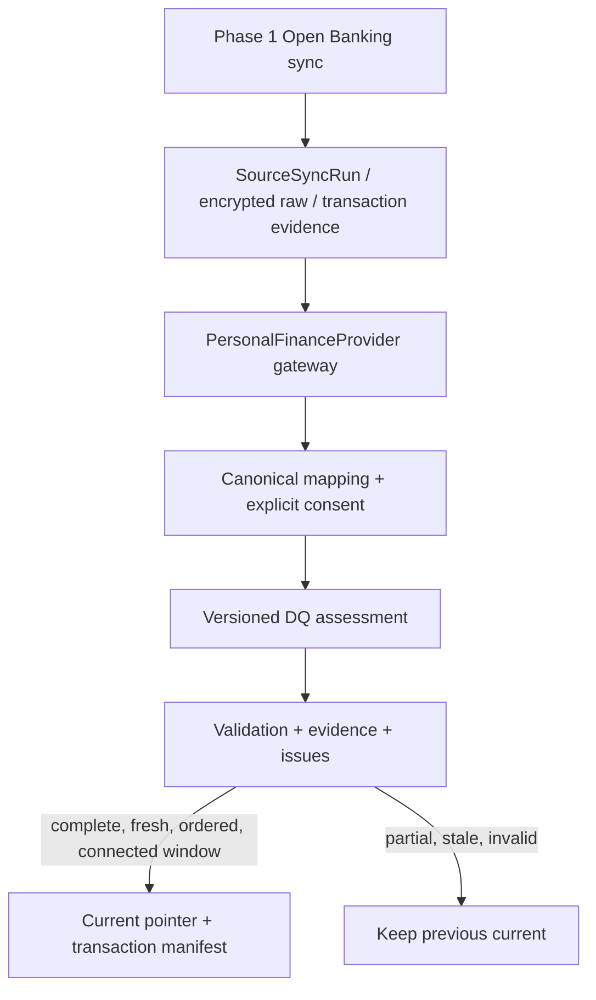

# Canonical Personal Finance / Data Quality — Phase 2

기준: 프로젝트 계획 PDF 28쪽 전체, 특히 p6의 product/personal 분리, p8 target domain, p10–11 canonical/DQ, p22 단계, p23 DoD. PDF SHA-256: `90733790831ed8deaa5607d3b45653f12404aa9e93056153a30d19aeee9bbf2b`.
사용자 승인 범위는 Phase 2까지이며 Phase 3는 미구현이다. 실제 KFTC 호출 상태는 **LIVE_TEST_NOT_VERIFIED**이다.

## 경계와 재사용



- `personal.gateway.PersonalFinanceProvider`: provider-neutral Java boundary. Connection metadata와 완료된 source batch를 읽는다. application canonical service에 Open Banking DTO가 전달되지 않는다.
- `personal.openbanking.OpenBankingPersonalFinanceProvider`: 기존 store/mapper/raw/identity/crypto를 재사용한다. HTTP pagination, OAuth, refresh, overlap, checkpoint를 다시 구현하지 않는다. 현재 run의 raw를 읽으므로 나중의 balance checkpoint로 과거 run을 잘못 재현하지 않는다.
- `personal.canonical.PersonalFinanceService`: grant/revoke/normalize/current/provenance service API. 새 HTTP endpoint나 consumer UI는 없다.
- `personal.quality`: 설정 가능한 freshness와 순수 DQ 규칙. 기존 상품 quality/publication/serving에는 연결하지 않는다.
- 저장은 기존 JdbcTemplate, PostgreSQL, Spring transaction, Flyway, Jackson, SecretBox를 사용한다. dependency 추가 없음.

## 도메인 및 V9 저장 모델

`V9__create_personal_finance_canonical_and_quality.sql`은 새 테이블 16개만 생성한다. V1–V8과 기존 상품/원천 테이블은 변경하지 않는다.

요청된 11개 개념의 typed record:

- `FinancialUser` / `financial_users`: 내부 UUID와 운영자 가명 ownerRef. 실제 사용자 인증 시스템은 아니다.
- `ConsentGrant` / `consent_grants`: provider, source connection, mode, demo/test kind, scopes, granted/expiry/revoked time.
- `FinancialAccount` / `financial_accounts`: 내부 UUID, opaque source key, nullable institution/type/currency, provenance.
- `BalanceSnapshot` / `balance_snapshots`: BigDecimal balance/available, currency, source asOf, provenance.
- `FinancialTransaction` / `financial_transactions`: 내부 UUID, account, occurredAt/postedAt, BigDecimal amount, direction, nullable description/merchant/category/balanceAfter/currency, sourceTransactionKey, provenance.
- `LoanAccount` / `loan_accounts`: principal, AnnualInterestRate, repaymentType/paymentDay/nextInterestDate 등 typed encrypted payload.
- `LoanPayment` / `loan_payments`: paidAt, principal/interest/total, currency, evidence.
- `CardAccount` / `card_accounts`: issuer/paymentAccount reference.
- `CardBill` / `card_bills`: billingDate/billedAmount/currency.
- `InvestmentPosition` / `investment_positions`: instrument/quantity/marketValue/currency.
- `IncomeEvidence` / `income_evidence`: verifiedAnnualIncome/incomeYear/employmentStatus/evidenceType/asOf. DB의 is_verified는 명시적 evidence 판정을 위한 필드이다.

보조 테이블 5개: `personal_validation_runs`, `personal_source_evidence`, `personal_validation_transactions`, `personal_current_states`, `personal_quality_issues`.

금융 payload는 암호화 JSON으로 저장하며 금액을 float/double로 변환하지 않는다. FK, owner/source-account uniqueness, account+transaction-key uniqueness, validation idempotency, enum/check, 시간 범위, current/account/capability 복합 FK를 사용한다. 계좌 생성과 첫 provenance 사이의 순환 참조는 deferred FK로 같은 transaction의 commit 시 검증한다. latest query는 validation_sequence index를 사용한다.

## Open Banking 매핑

- sourceAccountKey는 원시 계좌번호/fintech_use_num이 아니라 Phase 1 connection UUID이다. 별도의 canonical account UUID와 구별한다. 새 연결을 기존 계좌와 자동 병합하지 않는다.
- `account_type`는 원천 잔액 응답에 있을 때만 보존한다. institution/currency는 현재 계약에서 신뢰할 근거가 없어 NULL이다.
- `balance_amt`, optional `available_amt`: 기존 BigDecimal mapper 재사용. 음수 잔액 허용.
- 잔액 `api_tran_dtm`: Asia/Seoul에서 Instant로 변환한다. 없으면 Phase 1의 receivedAt fallback을 그대로 따른다. 수집 시각과 구별해 보관한다.
- `tran_date` + `tran_time`: Asia/Seoul → UTC occurredAt. postedAt은 원천에 없어 NULL.
- `tran_amt`는 비음수 BigDecimal, 입금→CREDIT/출금→DEBIT. after_balance_amt는 원천값 보존.
- print_content가 없거나 JSON null이면 description=NULL. 제공된 빈 문자열은 그대로 빈 문자열이다. merchant/category를 설명에서 추정하지 않는다.
- Phase 1 raw는 민감정보 정제 후 암호화된 evidence이다. 정제된 field가 원천값을 대신할 수 있으며 canonical은 해당 evidence에 충실하다.
- `sourceType=OPEN_BANKING_TEST`, `sourceMode=DEMO_REPLAY|LIVE_TEST`. 두 축은 별도 enum이다. DEMO는 실제 고객 데이터가 아니다.

SourceType의 전체 enum: REAL_PRODUCT_DATA, OPEN_BANKING_TEST, PUBLIC_MYDATA_MOCK, USER_INPUT, DERIVED, AIHUB_OFFLINE. enum 선언은 해당 provider 구현이나 데이터 존재를 의미하지 않는다.

## 거래 identity와 재현성

source-native 은행 거래 ID를 사용하지 않는다. Phase 1 `ob-composite-v1` identity 함수(HMAC)를 그대로 호출한다. 구성 요소는 일자/시각/입출금/거래종류/금액/거래후잔액/설명/지점이다. 원천 evidence의 저장된 mapped 값과 raw에서 다시 계산한 값이 일치하는지도 확인한다.

canonicalTransactionId(UUID)와 sourceTransactionKey(HMAC)를 분리한다. `(financial_account_id, source_transaction_key)` unique로 재실행해도 canonical 거래를 중복 저장하지 않는다. 같은 run+consent+policy version+stale threshold는 validation도 재사용한다. 같은 연결에서 fixture 반복 시 거래 UUID 및 내용 hash가 유지된다. 다른 새 DB/연결에서는 UUID까지 동일하다는 보장은 없다.

완전히 같은 관측값의 실제 별도 거래를 구별할 수 없다. 정정으로 구성 요소가 바뀌면 다른 관측이 될 수 있고 취소/반대거래를 원거래와 자동 연결하지 않는다. 이후 조회에서 사라진 항목을 삭제/취소로 추정하지 않는다. 따라서 거래 manifest는 검증된 관측의 누적 집합이며 은행 원장 전체와 동일하다는 주장이 아니다. 키 회전 및 재연결 시 identity migration 정책은 후속 운영 과제이다.

## Provenance

각 canonical record는 `provenanceId`를 가진다. 중앙 `personal_source_evidence`는 validation/sourceSyncRun/rawSnapshot, SourceType/SourceMode, asOf/collectedAt/normalizedAt, entityKind, 원천 배열의 0-based row index를 보관한다. endpoint/hash는 raw reference join으로 얻는다.

canonical → provenance → sourceSyncRun/raw → endpoint/receipt/hash 경로를 소유권과 유효 동의 scope를 검사한 service로 조회한다. raw plaintext는 반환하지 않는다. transaction record는 첫 관측 provenance를 유지하고 각 validation manifest는 재관측 evidence 또는 이전 검증에서 상속한 evidence를 별도로 갖는다. UUID/hash를 로그에 쓰지 않는다.

`contentHash`는 source type/mode/capability, 이번 요청 범위, balance 내용/asOf 또는 정렬한 unique 거래 키의 keyed hash이다. 누적 manifest 전체의 hash가 아니며 Financial Twin snapshot hash도 아니다. 개인정보 추측 공격을 줄이기 위해 키가 필요한 hash를 사용한다.

## 동의

grant는 존재하는 source connection의 owner와 upstream consent expiry를 먼저 확인한다. 현재 scopes는 BALANCE/TRANSACTIONS만 허용한다. DEMO_REPLAY는 DEMO, LIVE_TEST는 DEVELOPER_TEST 동의이다. 명시적 expiresAt을 upstream 동의보다 늦게 지정할 수 없다. DB microsecond 정밀도로 expiry를 저장해 grant 재시도를 안정적으로 처리한다.

normalize/current/provenance마다 owner, connection, mode, scope, canonical consent ACTIVE, upstream expiry를 검사한다. 같은 source connection row lock으로 동시 grant/revoke/normalize를 직렬화한다. commit 직전 동의 상태를 다시 검사한다. 철회/만료는 조회와 승격을 막는다. 새 동의에서는 해당 동의의 재정규화 전까지 이전 current를 노출하지 않는다.

철회는 canonical 접근을 막는 기능이며 OAuth token 폐기나 Phase 1 수집 자체의 중단을 구현한 것은 아니다. 원천 및 canonical audit를 삭제하지 않는다. 삭제/retention/legal consent UI는 미구현이다. 운영자 가명은 신원 인증을 대신하지 않는다.

## DQ와 승격

모든 영속 issue는 rule/severity/detectedAt/sourceSyncRunId/affectedEntity/details/resolution을 제공한다. details에는 고정된 reason 또는 duplicate count만 기록하고 원천 본문·식별자를 넣지 않는다.

- DUPLICATE_TRANSACTION: Phase 1 duplicateCount가 양수이면 INFO/RESOLVED. 기존 identity로 중복 저장을 막았다는 뜻이며 실제 별도 거래 여부를 해결했다는 뜻은 아니다.
- PAGINATION_INCOMPLETE: 거래 sync가 SUCCESS+complete가 아니면 ERROR/OPEN, PARTIAL. 원천 요청 실패도 불완전 거래 history로 취급한다.
- STALE_BALANCE: 임계시간을 초과한 잔액은 WARNING/OPEN, STALE. audit snapshot은 남기되 current 승격하지 않는다.
- MISSING_INCOME_EVIDENCE: 검증 연소득 evidence 부재는 WARNING/OPEN. 잔액/거래의 정상 승격을 막지 않는다. 급여처럼 보이는 설명을 verified annual income으로 바꾸지 않는다.
- LOAN_PAYMENT_MISMATCH: 명시적인 원금/이자/총액이 모두 있는 LoanPayment에 대해 비음수 및 합계 일치 검증. 누락값을 추정하지 않는다. 현재 실제 대출 provider가 없으므로 순수 규칙을 합성 unit fixture로 검증했으며 runtime 대출 issue/row는 생성하지 않는다.
- SOURCE_CAPABILITY_MISSING: provider 미지원은 WARNING/OPEN. 현재 CARDS/LOANS/LEASES/INVESTMENTS/INCOME에 발생하며 정상적인 정보 부족이다.
- 추가 보호 규칙: SOURCE_SYNC_FAILED, INVALID_SOURCE_DATA, DISJOINT_TRANSACTION_WINDOW, OLDER_OBSERVATION.

validation state는 VALIDATED_COMPLETE/PARTIAL/STALE/INVALID. complete는 요청 capability/기간의 수집 검증이며 개인의 전체 재무상태 완전성이 아니다. promoted는 별도 필드로, VALIDATED_COMPLETE여도 오래된 순서 또는 비연속 window라면 false가 된다.

정규화 records/evidence/DQ/manifest/current pointer는 하나의 REQUIRES_NEW transaction이다. 실패한 DB write는 모두 rollback되고 Phase 1 원천 sync/raw audit와 이전 current는 보존된다. DB 자체 장애의 실패 validation row를 별도 transaction으로 기록하는 기능은 없으며 호출자는 안전한 STORAGE_ERROR를 받는다.

새 불완전 run에서는 canonical 금융 rows를 만들지 않고 PARTIAL audit만 저장한다. 잘못된 mapping은 INVALID. 이전 정상 current를 유지하면서 current 조회에 latestAttempt와 `completeForLatestAttempt=false`를 함께 반환한다. stale run의 snapshot은 audit로 저장되지만 이전 정상 current pointer를 교체하지 않는다.

거래 current는 검증된 manifest로 읽는다. 연속/인접/overlap 기간은 이전 manifest를 상속하고 새 거래 관측을 합친다. 미조회 gap을 포함하는 disjoint window는 audit만 남기고 승격하지 않는다. 이전보다 늦게 정규화된 오래된 source run도 current를 뒤로 돌리지 않는다. 빈 기간을 끝까지 정상 조회한 경우 0건 complete로 표현한다. offset 0–1,000,000 / limit 1–100의 정렬된 조회를 제공한다.

## Freshness

`fincompass.data-quality.balance-stale-after` 기본값은 **24h**이다. 환경변수 `PERSONAL_BALANCE_STALE_AFTER`로 변경한다. 의미는 `asOf < now - threshold`; 정확한 경계는 fresh이다. 설정은 양의 정수 초, 최대 366일로 제한한다.

normalization 시 정책 버전(`personal-dq-v1`)과 threshold 초를 저장한다. 과거 평가를 덮어쓰지 않는다. current 조회 시 현재 설정과 Clock으로 freshness를 다시 계산하므로 재수집 없이도 STALE 경고를 낸다. 시간 경과만으로 새 DQ DB row를 만들지는 않는다. 과거 authoritative validation과 현재 effective state를 구별한다.

거래 시간 freshness는 NOT_EVALUATED이다. 거래의 범위와 latest attempt는 제공하지만 새로운 만료 SLA를 임의로 만들지 않는다. future Twin은 authoritative 뿐 아니라 latestAttempt, effectiveState, completeForLatestAttempt, coverage, warning을 반드시 함께 평가해야 한다.

## 미지원 데이터 및 알려진 제약

loan_accounts/loan_payments/card_accounts/card_bills/investment_positions/income_evidence는 비어 있다. LEASES도 unsupported이며 향후 계약 확정 전 lease schema는 추가하지 않았다. 상품 데이터를 개인 부채로 join하거나 replay를 PDF persona와 맞추지 않았다.

- 현재 계좌 metadata는 최초 canonical 관측에 고정된다. 거래를 먼저 정규화하면 accountType은 NULL로 남을 수 있다. 후속 계좌 metadata 변경의 versioning/승격은 아직 없다.
- Java provider boundary는 중립적이지만 connection/sourceSyncRun/raw FK는 현재 Phase 1 Open Banking storage를 참조한다. Phase 3 provider 추가 시 provider-neutral evidence/connection persistence를 additive migration으로 확장해야 한다. 미래 provider가 코드 변경 없이 꽂힌다고 주장하지 않는다.
- grant는 현재 balance/transactions scopes만 수용한다. INCOME 등의 scope, provider별 consent, income provenance/verification validation은 Phase 3 승인 후 확장한다.
- 단일 연결의 동시 작업은 row lock으로 직렬화하며 대량 데이터 incremental batch 성능 최적화는 미구현이다. raw와 기존 거래 evidence를 요청 범위 단위로 메모리에 읽는다.
- 실제 LIVE_TEST 호출은 미실시. endpoint/client/redirect/권한/테스트 계좌/기관 prefix/안정적인 key가 준비되어야 한다.
- 운영 인증/인가, 보존·파기, 키 회전, crash RUNNING 복구는 기존 부채로 남는다. 개인정보 장기 운영 준비 완료 선언이 아니다.

## Golden replay와 실행

Phase 1 fixture를 그대로 사용한다. 2026-09-01~02 거래 28건/2 page, 잔액 1건 balance=1,500,000 / available=1,400,000 / asOf=2026-09-21T00:00:00Z. golden canonical은 account 1개, balance snapshot 1개, transaction 28개, sourceType=OPEN_BANKING_TEST/sourceMode=DEMO_REPLAY이다. unsupported 6개 domain table은 모두 0건이다. 고정 fixture timestamp 때문에 나중에 실행하면 잔액이 STALE로 나오는 것이 정상이다. 테스트는 Clock을 고정한다.

기본 personal module은 disabled이며 기존 실행에 영향을 주지 않는다. 실행하려면 환경변수로 기존 DATABASE 설정, `OPEN_BANKING_ENABLED=true`, `OPEN_BANKING_MODE=DEMO_REPLAY`, `OPEN_BANKING_ENCRYPTION_KEY`(32-byte Base64), `PERSONAL_FINANCE_ENABLED=true`를 제공한다. LIVE credential은 replay에 필요 없다. key/credential은 commit하지 않는다.

```sh
./gradlew bootJar
java -jar build/libs/loanops-0.0.1-SNAPSHOT.jar \
  --spring.profiles.active=manual-personal-finance \
  --spring.main.web-application-type=none
```

manual profile은 전용 local demo DB용이며 매번 새 합성 connection과 명시적 demo consent를 만든다. 새 연결 간 dedupe를 보여주는 runner가 아니다. 같은 connection의 반복 idempotency는 integration test에서 검증한다. 실행 결과는 상태와 건수만 출력하며 앱을 종료한다.

## Phase 3 인계 — 승인 전 구현하지 않음

1. PUBLIC_MYDATA_MOCK 계약/버전/필드와 persona를 확정하고 중립 connection/evidence reference를 확장한다. OB adapter를 재사용하는 척 데이터를 섞지 않는다.
2. PersonalFinanceProvider에 별도 구현을 연결하고 provider별 scope/consent/명시적 MOCK 원산지를 보장한다.
3. IncomeEvidence의 증빙 연도/asOf/verification 의미, LoanPayment explicit component 규칙을 provider ingest에 연결한다. 설명 기반 소득 추론은 금지한다.
4. 현재 stale/partial/invalid/promotion/provenance/read API 계약과 기존 89개 regression을 유지한다. 금융 snapshot/analytics/Financial Twin은 Phase 4 경계로 남긴다.

실제 실행 결과와 명령은 `PHASE2_VALIDATION.md`, 단계 상태는 `STATUS.md`에 기록한다.
