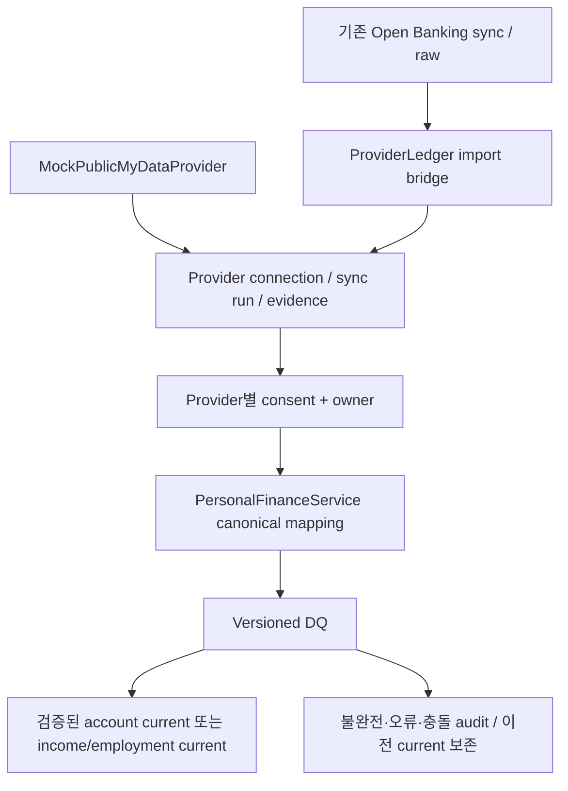

# Phase 3 — Public MyData Mock + Provider Generalization

2026-09-21. 승인 범위: Phase 3까지. **실제 정부 API 연동 아님 / PUBLIC_MYDATA_MOCK**. 실제 KFTC는 계속 LIVE_TEST_NOT_VERIFIED. Financial Twin/analytics/계산/매칭/Agent/consumer UI/AI-Hub runtime provider는 구현하지 않았다.

## 요구사항 및 공식 자료 확인 범위

제품 기준은 프로젝트 PDF 전체 28쪽, 특히 p6 경계, p8 provider, p10 §6.6, p11 verified/observed 분리, p22 단계, p24 연소득 persona이다. 기존 PDF나 Open Banking fixture를 변경하지 않았다.

2026-09-21에 확인한 공식 자료:

- [공공 마이데이터 업무포털 이용기관 신청·승인](https://adm.mydata.go.kr/intro/addHelpPage.do?type=index): 이용기관 신청/환경조사/묶음정보/심사 절차.
- [제공요구 가능 본인정보 목록](https://www.mydata.go.kr/pc/intro/pvsnTrgtSfif.do): 소득금액증명, 건강보험 자격확인/자격득실 정보가 별도 문서 유형이다.
- [공공 마이데이터 서비스 수행 가이드 개정(안), 250410 파일](https://adm.mydata.go.kr/images/guide_250410.pdf): PDF 파일 p57(인쇄 p52) 요청/수취 API 세트, p60–62(인쇄 p55–57) 발급/수취, p72(인쇄 p67) 제공요구 항목을 확인했다. 최초 web fetch timeout 이후 공개 PDF를 직접 받아 확인했다. 원문 제목의 ‘개정(안)’ 표기도 그대로 구분한다.

이 구현은 해당 문서의 **동의 → 필요한 묶음정보 요청 → evidence 수취·보관 → 최소 canonical projection** 구조를 따르는 내부 Mock이다. `pmd-minimal-v1` JSON은 프로젝트 내부 계약이다. 실제 정부 필드명/서명/header/요청·수취 wire schema에 대한 인증이나 호환성 검증을 주장하지 않는다. 특히 EMPLOYMENT_ELIGIBILITY는 데모 목적의 단순 상태이며 실제 건강보험 가입자 구분을 재직으로 자동 판정하는 알고리즘이 아니다.

## Provider 일반화와 Open Banking 호환성



- `PersonalFinanceProvider`: 공통 connection/read/consentScopes와 SourceBatch. 기존 account/balance/transaction 계약을 유지하고 IncomeObservation을 추가했다.
- `PublicMyDataProvider`: 최소 묶음 evidence 요청 경계. 구현은 `MockPublicMyDataProvider` 하나이다.
- `RealPublicMyDataProvider`: 미래 구현용 interface만 선언했다. bean/network/OAuth/API-key flow는 없다. 실기관 승인과 최신 상세 계약 검증 후 별도 구현해야 한다.
- `ProviderLedger`: 공통 metadata와 명시적 owner 관계. Open Banking import만 기존 V8 테이블을 읽는다.
- 기존 OpenBankingProvider/client/OAuth/token/pagination/identity/fixture는 변경하지 않았다. 공통 adapter는 기존 class/table을 rename하지 않고 terminal run과 raw 참조를 bridge한다.
- `PersonalFinanceService`의 grant/revoke/normalize/provenance를 공유한다. 새 service method는 createDemoUser/connectPublicMyDataMock/collectMock/currentIncome이다. HTTP endpoint 없음.

## V10 migration

`V10__generalize_personal_provider_evidence.sql`:

1. provider_connections: financialUser FK, provider/mode/expiry, optional legacy connection FK.
2. provider_sync_runs: connection/capability/수집 status/time, optional legacy source run FK.
3. provider_evidence: generic run, fixture ID/계약 버전/asOf/collectedAt/hash/source/mode, 암호화 payload 또는 legacy raw reference, 수집 consent.
4. provider_current_evidence: connection+INCOME/EMPLOYMENT별 current validation pointer.
5. provider_access_issues: 유효 동의가 없어 canonical validation을 만들 수 없는 거절 audit.

기존 consent_grants/personal_validation_runs/personal_source_evidence에 공통 FK를 추가하고 기존 rows를 backfill한다. 기존 Open Banking FK는 삭제하지 않고 해당 컬럼의 NOT NULL만 완화한다. OB rows는 구 FK와 신 FK를 모두 유지하고, PMD rows는 OB FK가 NULL이다. 기존 상품 테이블 및 V1–V9 파일은 변경하지 않았다.

기존 source evidence payload와 canonical account/current를 재작성하지 않는다. V8-only 연결은 첫 canonical grant 시 bridge한다. 아직 RUNNING인 source는 종료 후 정규화할 때 import한다. ownership FK, provider-scope CHECK, evidence↔run 및 provenance↔validation-run 복합 FK, idempotency index를 추가했다. PMD 수집은 OB 테이블에 가짜 연결/run/raw를 넣지 않는다.

V10 이후 Phase 2 구버전 binary로의 무계획 rollback은 지원하지 않는다. 새 NOT NULL 공통 참조를 쓰는 binary와 migration을 함께 배포해야 한다. 운영/기존 Loanops DB에는 적용하지 않았고 임시 PostgreSQL에서 clean migration 및 실제 V9 rows backfill을 검증했다.

## Mock 계약과 personas

fixture 경로: `src/main/resources/fixtures/public-mydata/`.

내부 묶음 envelope는 `contractVersion`, `fixtureId`, `evidence[]`뿐이다. evidence는 `evidenceType`, `verifiedAnnualIncome`, `incomeYear`, `employmentStatus`, `currency`, `asOf`만 허용한다. 요청 scope에 해당하는 항목만 반환한다. 최대 10개 evidence, 18자리 정수부/소수 2자리 금액, enum/연도 범위/날짜를 검사한다. 알 수 없는 필드나 malformed payload는 원문 대신 `rejected` marker만 암호화 저장하고 INVALID로 평가한다.

- **main-home-buyer-v1 / PMD-DEMO-001**: INCOME_CERTIFICATE 66,000,000 KRW, 귀속연도 2025; 별도 EMPLOYMENT_ELIGIBILITY EMPLOYED.
- **self-employed-v1 / PMD-DEMO-002**: INCOME_CERTIFICATE 48,000,000 KRW, 2025; 별도 EMPLOYMENT_ELIGIBILITY SELF_EMPLOYED. 금액은 명시적 합성 예시이다.
- **missing-income-v1 / PMD-DEMO-003**: income evidence 없음, employment UNKNOWN. INCOME은 PARTIAL/MISSING_INCOME_EVIDENCE, EMPLOYMENT도 검증된 current로 승격하지 않는다.

모든 asOf는 2026-09-01T00:00:00Z로 고정한다. 시간이 지나도 fixture 시각을 몰래 현재로 바꾸지 않는다. 같은 fixture가 항상 fresh라는 뜻이 아니다. government identifier/회사명/가입자번호/실제 문서/이미지는 없다. fixture IDs는 코드에서 허용한 synthetic opaque ID이다.

## Canonical IncomeEvidence / Employment

Phase 2 IncomeEvidence를 확장했다. 필드:

- id/userId, verifiedAnnualIncome(BigDecimal), incomeYear(Integer), currency.
- employmentStatus(enum EMPLOYED/SELF_EMPLOYED/UNEMPLOYED/UNKNOWN), evidenceType(enum INCOME_CERTIFICATE/EMPLOYMENT_ELIGIBILITY), asOf.
- provenanceId, providerEvidenceId, consentGrantId, sourceType/sourceMode, collectedAt/normalizedAt.

소득증명과 재직 evidence를 별도 rows와 capability current로 보관한다. 소득 row의 employmentStatus=NULL, 재직 row의 annualIncome/incomeYear/currency=NULL을 유지한다. 재직만으로 소득을 만들지 않는다. 0원은 명시적으로 제공된 유효 금액일 수 있으며 NULL과 구별한다.

sourceType는 항상 PUBLIC_MYDATA_MOCK, sourceMode는 DEMO_REPLAY이다. `verifiedAnnualIncome`와 is_verified는 **Mock 계약 안에서 검증된 증빙 금액**이며 실제 정부가 사용자의 소득을 검증했다는 표현이 아니다. 정상 INCOME 평가만 is_verified=true이고 employment 또는 partial/invalid/stale 후보는 false이다.

## 동의 및 identity linkage

provider별 scopes를 Java와 DB에서 분리한다:

- OPEN_BANKING: BALANCE, TRANSACTIONS.
- PUBLIC_MYDATA: INCOME, EMPLOYMENT.

동의는 DEMO/DEVELOPER_TEST, owner, provider connection, scope, granted/expiry/revoked time을 가진다. 수집 전·수집 후·정규화 전·승격 직전·조회 시 검사한다. expiry는 source connection보다 늦을 수 없다. 동시 grant/revoke/collection/normalization은 provider connection row lock으로 직렬화한다.

유효 동의가 없으면 금융 payload를 새로 수집하지 않고 owned connection에만 CONSENT_MISSING/EXPIRED/REVOKED/SCOPE_DENIED metadata audit를 남긴다. 잘못된 소유자에게는 evidence나 연결 존재를 반환하지 않는다. 수집 후 동의가 만료되면 저장된 원천은 audit로 남고 정규화·current 접근은 차단된다. 동의 철회 후 이전 pointer와 evidence는 삭제하지 않는다. 새 동의에서는 해당 동의로 재수집/재정규화하기 전 current를 보여주지 않는다.

`createDemoUser(owner)`가 만든 UUID를 `connectPublicMyDataMock(owner,financialUserId,expiry)`에 명시적으로 전달한다. 실제 JAR demo는 같은 명시적 owner alias의 Open Banking connection에 grant를 발급하고 두 consent.userId의 일치를 확인한다. fixture ID/계좌번호/원천 값이 같다는 이유로 user를 merge하지 않는다. 같은 persona를 다른 사용자에게 로드하면 별도 evidence/연결이 된다. 운영자 alias는 consumer 인증을 대체하지 않는다.

## Provenance와 idempotency

fixture → provider_evidence → personal_source_evidence → income_evidence. provider_evidence는 최소 암호화 JSON, fixture ID/contract version, 수집 consent, source type/mode/asOf/collectedAt/hash를 보관한다. malformed/missing evidence의 asOf metadata는 수집시각 fallback이며 valid evidence의 시각과 혼동하지 않는다.

공통 Provenance DTO에 providerEvidenceId/consentGrantId를 추가했다. 기존 sourceSyncRunId accessor는 공통 provider_sync_runs ID를 뜻하며 OB에서는 기존 UUID와 같아 호환된다. PMD rawSnapshotId는 NULL이다. endpoint는 실제 정부 URL이 아닌 `mock:public-mydata/minimal-v1`이다.

Open Banking 기존 response hash는 원래 SHA-256을 유지한다. Mock 응답 hash는 암호화 key에서 파생한 HMAC이며 내부 minimized payload 기준이다. canonical contentHash는 금융 내용/귀속연도/status/type/currency/asOf만 사용하고 run UUID/receipt time을 제외한다.

동일 connection+consent+capability+동일 minimized payload는 기존 run/evidence를 재사용한다. 같은 run+정책 재정규화도 idempotent이다. 따라서 동일 fixture 재실행이 collectedAt을 새로 써서 증빙을 fresh로 만들지 않는다. 새 payload/동의/정책이면 새 audit 평가가 남는다. 새 DB/새 연결의 UUID가 같다는 보장은 없다.

## DQ, stale, current

Phase 2의 issue 구조와 current 보존 원칙을 재사용한다.

- MISSING_INCOME_EVIDENCE: absent/null annual income/year/currency → PARTIAL.
- STALE_INCOME_EVIDENCE: asOf age 초과 → STALE. 수집이 최근이어도 원천 기준일이 오래되면 stale이다.
- INCOME_YEAR_OUTDATED: 귀속연도 적합성 초과 → STALE. freshness와 별도 판정한다.
- CONSENT_MISSING/EXPIRED/REVOKED/SCOPE_DENIED: 수집·정규화 거절, metadata audit.
- SOURCE_CAPABILITY_MISSING: unsupported 또는 UNKNOWN/missing employment → PARTIAL.
- INVALID_SOURCE_DATA: malformed/계약 위반/미래 시각 5분 초과/현재연도 이상 annual-income year 등 → INVALID.
- CONFLICTING_INCOME_EVIDENCE: 복수 후보 bundle 또는 동일 귀속연도·동일 asOf의 서로 다른 소득 → INVALID. 동일 asOf의 재직 상태 충돌도 차단한다. 자동 평균/합산/선택 없음.
- OLDER_OBSERVATION: 이전 current보다 오래된 asOf 또는 더 오래된 incomeYear로 current를 후퇴시키지 않는다.

설정:

- `fincompass.data-quality.income-evidence-stale-after` / `PERSONAL_INCOME_EVIDENCE_STALE_AFTER`: **180d**. 0 초 초과, 정수 초, 최대 1825일.
- `fincompass.data-quality.max-income-year-age` / `PERSONAL_MAX_INCOME_YEAR_AGE`: **2**. 허용값 1–10. UTC 현재연도 Y에서 완료된 귀속연도 [Y−2, Y−1]을 기본 적합 범위로 한다.
- 정확히 stale threshold와 같은 경계는 fresh. 잔액 24h 정책과 구별한다.

이 값은 프로젝트 demo 정책이며 행정문서의 법적 유효기간이 아니다. 정책 버전과 실제 threshold/year-age를 validation에 보존한다. 조회 시 현재 설정으로 freshness와 year relevance를 다시 평가하며 과거 validation은 덮어쓰지 않는다.

current는 connection+capability별이다. valid 신규 evidence가 더 최신이면 교체한다. partial/invalid/stale/conflicting 후보는 audit에 남고 이전 정상 current를 보존한다. 조회는 authoritative와 latestAttempt/effectiveState/completeForLatestAttempt/warnings를 함께 반환한다. 이전 정상값이 있다는 이유로 최신 실패를 complete로 숨기지 않는다.

수집 transaction과 canonical transaction을 분리했다. canonical DB write 실패 시 canonical/DQ/current 변경은 rollback되고 이미 수집된 provider evidence는 남는다. 원천 수취 SUCCESS는 canonical VALIDATED_COMPLETE를 의미하지 않는다. 프로세스 crash로 수집 이후 미정규화 run이 남으면 명시적으로 normalize를 재실행한다.

## Verified와 observed의 분리

Open Banking의 거래 설명·급여성 입금으로 IncomeEvidence를 생성하지 않는다. 기존 거래 28건/금액/identity는 그대로다. 같은 명시적 사용자의 유효·current·fresh 소득 evidence 유무는 DQ의 결측 경고에만 사용하며 거래와 소득금액을 합산하거나 analytics를 계산하지 않는다.

## 실행과 보안

새 dependency 없음. 기존 SecretBox AES-GCM/AAD를 재사용한다. 두 provider를 함께 켜면 기존 Open Banking key를 공통으로 사용한다. Open Banking을 끈 MyData 단독 실행에는 `PERSONAL_FINANCE_ENCRYPTION_KEY`로 Base64 32-byte key를 주입한다. 기존 DB를 두 실행 방식으로 전환할 때도 동일 key를 유지해야 한다. key 회전/재암호화는 미구현이다.

```sh
# DATABASE_* 및 OPEN_BANKING_ENCRYPTION_KEY는 안전한 환경 주입 사용
export PERSONAL_FINANCE_ENABLED=true
export OPEN_BANKING_ENABLED=true
export OPEN_BANKING_MODE=DEMO_REPLAY
./gradlew bootJar
java -jar build/libs/loanops-0.0.1-SNAPSHOT.jar \
  --spring.profiles.active=manual-public-mydata \
  --spring.main.web-application-type=none
```

전용 demo DB에서만 실행한다. runner는 explicit-main-demo 사용자에 새 두 연결과 consent를 만들고 Main persona income/employment 및 기존 OB balance/transactions를 정규화한다. 로그는 상태/건수만 출력하고 식별자/금액/증빙 본문을 출력하지 않는다. 실제 정부 API나 금융결제원 API를 호출하지 않는다.

raw 주민번호/정부 credential/보험 가입자번호/고용주 식별자/문서 이미지/실문서는 수집하지 않는다. known fields allowlist와 unknown-field omission, 암호화, owner/scope gating, redacted toString, 안전한 오류 category를 사용한다. 보존·파기/운영 인증/외부 KMS는 여전히 별도 운영 과제이다.

## 한계와 Phase 4 인계

- 실제 정부 연계·전자서명·문서 진위 검증 없음. Real interface를 구현하려면 승인 환경과 상세 contract 검증이 필요하다.
- current는 connection별이다. 서로 다른 연결의 evidence를 사용자 단위로 자동 합치거나 우열을 정하지 않는다. Phase 4는 연결 선택/소득 기준 정책을 명시해야 한다.
- 소득과 재직은 별도 증빙이다. 한쪽의 성공을 다른 scope의 성공으로 간주하면 안 된다.
- 첫 Open Banking 계좌 metadata 고정, 거래 정정/동일 관측값 구별, consumer 인가, retention, key rotation은 잔여 부채이다.
- provider 일반화는 metadata/consent/provenance에 한정했다. 기존 financial_accounts와 계좌 current는 Open Banking 역할을 유지한다. PMD가 이를 필요로 하지 않는다. 다른 계좌 provider 추가는 아직 승인 범위가 아니다.
- Main demo는 연소득 66,000,000/EMPLOYED와 기존 OB 1,500,000 잔액·28건 거래의 source linkage만 제공한다. PDF 120,000,000 자산·30,000,000 부채·생활비/카드청구를 맞추기 위한 데이터를 만들지 않았다.
- **Phase 4 승인 후** Golden Twin fixture의 추가 가정·소득 기준·통화/기간·불완전 evidence 처리·계산 trace를 먼저 정하고 구현한다. 이번 단계에서 FinancialSnapshot/Net Worth/Free Cashflow/analytics는 계산하지 않았다.

검증 명령과 실제 결과: `PHASE3_VALIDATION.md`.
